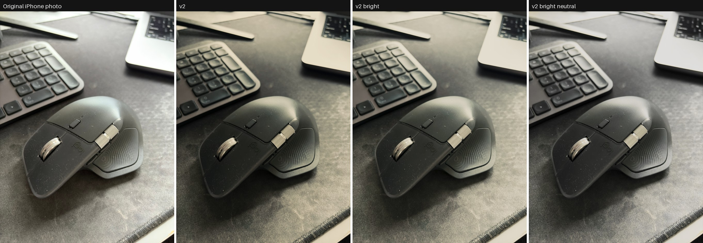

# iPhone Film-Print LUT

An unofficial, approximate recreation of the look of [Chromagraph Camera](https://www.chromaticapplications.com/chromagraph/chromagraph), the iPhone app by Rian Johnson, Steve Yedlin and Eric Cameron. It ships as `.cube` LUTs that you apply to ordinary iPhone photos.

This project is not affiliated with Chromatic Applications. The LUTs were fitted only from photo comparisons people posted publicly. Nobody downloaded, decrypted or disassembled the app.



## LUT files

Each file is a 33-point 3D LUT. Input and output are both sRGB-encoded. Apps that colour-manage convert iPhone Display P3 photos for you. None of the files adds grain or halation.

| File | What it does | Use it when |
|---|---|---|
| [chromagraph_v2_33.cube](luts/chromagraph_v2_33.cube) | The fitted look at the fitted exposure. It is the closest to Chromagraph on held-out photos. It is also dark, because Chromagraph is. | You want the most faithful version. |
| [chromagraph_v2_bright_33.cube](luts/chromagraph_v2_bright_33.cube) | The same look with shadows lifted 0.75 stop; white stays where it is. | Everyday use. **Recommended.** |
| [chromagraph_v2_brighter_33.cube](luts/chromagraph_v2_brighter_33.cube) | The same look with shadows lifted 1.5 stops. | Dim or indoor photos. |
| [chromagraph_v2_bright_neutral_33.cube](luts/chromagraph_v2_bright_neutral_33.cube) | The bright version, with greys and whites kept free of colour cast. | You dislike the cream highlights. This departs from the app, which does turn bright whites cream. |

**Experimental (v3)**, in [luts/experimental](luts/experimental). v3 adds a per-hue saturation and hue correction. It scores slightly better than v2 on typical pixels and slightly worse on the worst ones. Its corrections for saturated blues and magentas rest on little data, so blue or purple objects may look off. v2 bright remains the recommended file.

| File | What it does |
|---|---|
| [chromagraph_v3_33.cube](luts/experimental/chromagraph_v3_33.cube) | v3 at the fitted exposure. |
| [chromagraph_v3_bright_33.cube](luts/experimental/chromagraph_v3_bright_33.cube) | v3 with shadows lifted 0.75 stop. |
| [chromagraph_v3_bright_neutral_33.cube](luts/experimental/chromagraph_v3_bright_neutral_33.cube) | v3 bright, with greys and whites kept free of colour cast. |

## Use it

**iPhone:**
1. AirDrop a `.cube` file to the phone and save it to Files.
2. In Files, long-press the file, then tap Share and pick a LUT app. VideoLUT is tested; LUTify should also work.
3. Apply it to a photo and export.

The Photos app and Lightroom Mobile cannot load `.cube` files.

**Mac or PC:**

```bash
uv run --no-project --python 3.12 --with numpy --with scipy --with pillow --with pillow-heif \
  python tools/apply_lut.py luts/chromagraph_v2_bright_33.cube photo.heic
```

This writes `photo_chromagraph.jpg` next to the input.

## How it was made

1. **Research.** Public sources describe the app's pipeline: RAW capture, scene-linear processing, a measured film-print colour transform, then grain and halation. See [docs/research.md](docs/research.md).
2. **Data.** I collected 16 public pairs of the same scene, one shot with the stock iPhone camera and one with Chromagraph, mostly from X. 9 were usable for fitting; the rest serve as visual checks only.
3. **Registration.** Each Chromagraph image is warped onto its stock image using feature matching and a RANSAC homography. Pairs that do not line up are dropped automatically.
4. **Fit.** The model has four parts:
   - a per-pair exposure gain;
   - a monotonic tone curve;
   - a smooth 3D colour residual, a regularised radial-basis-function fit;
   - two constraints: grey inputs stay neutral wherever the data shows that, and making an input brighter never makes the output darker.
5. **Validation.** Each pair is left out in turn: the LUT is fitted on the others and scored against the held-out pair's real Chromagraph image.

Run the whole pipeline with `tools/fit/fit_look.py`. The pair images are not included; [tools/fit/pairs.json](tools/fit/pairs.json) lists the file names, and the sources are linked below.

## Results

Scores are CIEDE2000, a standard colour-difference measure where lower is better and about 1 is just noticeable. Each figure is the mean over the 9 held-out pairs.

| Version | Median | 95th percentile |
|---|---|---|
| Stock photo, unchanged | 14.5 | 23.5 |
| v1 (4 pairs) | 7.4 | 15.6 |
| **v2 (9 pairs)** | **6.7** | **14.7** |
| v3 (experimental) | 6.4 | 14.9 |

v2 beats v1 on 7 of the 9 pairs. v3 beats v2 on 4 of the 9. The full numbers are in [docs/fit-report.md](docs/fit-report.md).

**What matches:**
- the film-style tone curve;
- blue skies shifting to muted cyan-cream;
- cream highlights;
- neutral shadows.

**Known gaps:**
- Some photos show Chromagraph keeping strong reds and oranges saturated, and the LUTs mute them. Only 2 of 8 public pairs show that behaviour. The rest show Chromagraph muting warm colours too, so no single LUT can match every scene.
- The input is Apple's already-processed photo. Apple's local tone mapping varies from scene to scene, so a single LUT can only approximate the app.
- There is no grain or halation.

## Sources

The comparison images are linked rather than rehosted, because they belong to their authors.

- X posts:
  - [@MisterSliwex](https://x.com/MisterSliwex/status/2115554291435860130)
  - [@WatchTheBreaks](https://x.com/WatchTheBreaks/status/2115502464711688612)
  - [@DriftGauge](https://x.com/DriftGauge/status/2115584930231042546)
  - [@fahim_al_mahmud](https://x.com/fahim_al_mahmud/status/2116015592788615259)
  - [@robby_weidemann](https://x.com/robby_weidemann/status/2115620405427744779)
  - [@satoruslander](https://x.com/satoruslander/status/2115497461288714666)
  - [@AlliCinema](https://x.com/AlliCinema/status/2115915179414216880)
  - [@absoIute_batman](https://x.com/absoIute_batman/status/2115605232780771636)
  - [@kiriyasan_1123](https://x.com/kiriyasan_1123/status/2116128803709956578)
  - [@pallavmac](https://x.com/pallavmac/status/2115871971103977530)
  - @bencsin ([1](https://x.com/bencsin/status/2115790917512974792), [2](https://x.com/bencsin/status/2115899308059009024))
- [AppleInsider review](https://appleinsider.com/articles/26/10/28/rian-johnsons-chromagraph-camera-app-brings-his-cinematic-style-to-your-iphone-photos)
- [MacRumors forum post by VSG](https://forums.macrumors.com/threads/rian-johnsons-iphone-camera-app-goes-viral.2493228/page-3?post=34925677)

The example photos in `examples/` are my own, with metadata removed.

## Repository layout

```text
luts/       the .cube files
examples/   before/after comparisons on my own photos
tools/      apply_lut.py, brighten_lut.py, neutralize_lut.py; fit/ holds the fitting pipeline
docs/       research notes and the full fit report
```

## License

MIT; see [LICENSE](LICENSE). "Chromagraph" is a trademark of its owner and is used here only to describe what this project approximates.
